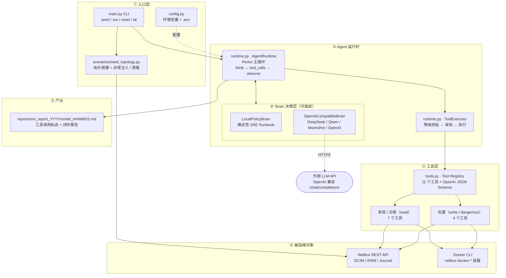
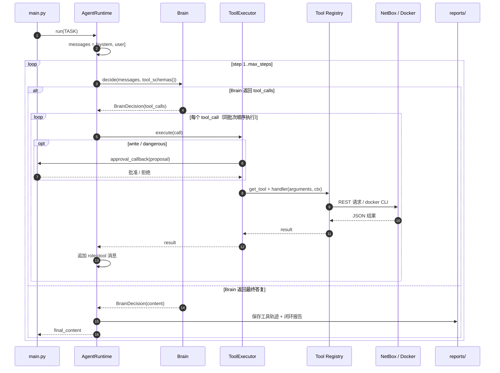

# AI-Native SRE Agent（NetBox Tool-Calling 闭环）

一个具备**真正的 Tool Calling 结构**的 SRE 值班 Agent，以 [netbox-docker](https://github.com/netbox-community/netbox-docker.git)
部署的 NetBox（DCIM/IPAM）及其 Docker 承载环境为运维对象，完成完整闭环：

> **发现异常 → 诊断根因 → 最小影响处置 → 复核验证 → 汇总报告**

工具协议、主循环、执行器、审批与报告全部由本仓库实现，不依赖 LangChain 等 Agent 框架，
唯一第三方依赖是 `requests`。

## 核心特性

| 特性 | 说明 |
|------|------|
| 标准 Tool Calling | 工具定义与消息格式严格遵循 OpenAI function-calling 协议 |
| 双大脑可插拔 | 默认 `LocalPolicyBrain`（确定性 Runbook，离线可用）；配置 LLM Key 后切换为任意 OpenAI 兼容模型 |
| 分级安全 | `read` 直接执行；`write` / `dangerous` 必须经过审批回调 |
| 白名单约束 | 对象类型、可删除类型、Journal 目标、可操作容器前缀均有白名单 |
| 证据驱动 | 只有工具返回的证据能明确区分“陈旧数据”时才自动处置，否则转人工研判 |
| 全程留痕 | 处置动作写回 NetBox Journal；每次运行落盘工具轨迹 + 中文闭环报告 |

## 架构

整体采用分层设计：**入口层 → Agent 运行时 → Brain 决策层（可插拔）→ 工具注册表 → 基础设施**。

### 分层架构图



> 部署上，Agent 进程独立于 NetBox 运行；只需能访问 `NETBOX_URL`，并在使用容器类工具的主机上可执行
> `docker` CLI（默认只允许操作 `netbox-docker-*` 前缀的容器）。

### 一次运行的时序



### 闭环阶段与 Brain 决策

`LocalPolicyBrain` 把值班 Runbook 固化为 6 个阶段，每一步都基于消息历史中**真实返回的工具结果**做条件决策：

| 阶段 | 行为 | 主要工具 |
|------|------|----------|
| 0 发现 | 首轮并行巡检 | `netbox_service_health`、两个扫描器、`docker_container_status` |
| 1 诊断 | 对每个异常取证（IP 占用点、前缀详情、设备上下文） | `netbox_get_ip_assignments`、`netbox_get_object`、`netbox_get_device_context` |
| 2 处置 | 按证据生成最小影响计划，写操作逐个审批 | `netbox_update_object`、`netbox_delete_object` |
| 3 审计 | 对成功的处置动作补写 NetBox Journal | `netbox_add_journal_entry` |
| 4 复核 | 仅当发生过处置时二次扫描，确认异常归零 | 两个扫描器 |
| 5 汇总 | 输出中文 Markdown 闭环报告 | — |

## 快速开始

### 前置条件

- Python >= 3.10
- 可访问的 NetBox v4.x（演示环境为 v4.7），并持有 API Token（v2 格式 `nbt_<key>.<token>`）
- 如需容器健康检查 / 重启工具：Agent 所在主机可执行 `docker` CLI，且仅操作 `netbox-docker-*` 容器

### 安装与配置

```bash
git clone <repo-url> sre-agent
cd sre-agent

python3 -m venv .venv
source .venv/bin/activate
pip install -r requirements.txt

cp .env.example .env
# 编辑 .env，至少填写 NETBOX_URL 与 NETBOX_TOKEN
```

`.env` 由 `main.py` 中的极简加载器读取（不覆盖已存在的环境变量），也支持直接用环境变量注入。

### 运行

```bash
# 完整演示：注入拓扑与异常 → Agent 全闭环（自动批准写操作）
python3 main.py all --approve-all

# 分步执行
python3 main.py seed    # 只注入演示数据
python3 main.py run     # 只跑 Agent 闭环
python3 main.py reset   # 清理演示数据

# 交互审批：每个写操作询问 y/N
python3 main.py run

# 强制使用本地策略大脑
python3 main.py run --brain local
```

| CLI 参数 | 说明 |
|----------|------|
| `command` | `seed` / `run` / `reset` / `all`，默认 `all` |
| `--approve-all` | 自动批准所有 `write` / `dangerous` 操作 |
| `--brain auto` | 默认。配置了 `SRE_LLM_API_KEY` 则使用 LLM 大脑，否则使用本地策略大脑 |
| `--brain local` | 强制使用本地策略大脑 |
| `--brain llm` | 使用 `build_brain()` 的选择逻辑：有 LLM Key 用 LLM，否则回退本地 |

### 配置项

| 环境变量 | 默认值 | 说明 |
|----------|--------|------|
| `NETBOX_URL` | `http://192.168.247.61:8000` | NetBox 地址 |
| `NETBOX_TOKEN` | 空（必填） | NetBox API Token |
| `SRE_LLM_BASE_URL` | `https://api.openai.com/v1` | OpenAI 兼容 API 地址 |
| `SRE_LLM_API_KEY` | 空 | 为空时自动使用本地策略大脑 |
| `SRE_LLM_MODEL` | `gpt-4o-mini` | 模型名，如 `deepseek-chat` |
| `SRE_MAX_STEPS` | `25` | Agent 主循环最大步数 |
| `SRE_HTTP_TIMEOUT` | `30` | NetBox HTTP 请求超时（秒） |

## Tool Calling 协议

工具定义与消息格式和 **OpenAI function calling 完全一致**：

```python
# 工具定义（tools 列表，由 Tool Registry 自动导出）
{
  "type": "function",
  "function": {
    "name": "netbox_delete_object",
    "description": "删除 NetBox 对象（DELETE）。危险操作，必须审批...",
    "parameters": {"type": "object", "properties": {...}, "required": [...]}
  }
}

# 决策（assistant 消息）
{"role": "assistant", "tool_calls": [{"id": "s1_c0", "type": "function",
   "function": {"name": "netbox_delete_object", "arguments": "{\"object_type\": \"prefixes\", \"id\": 6}"}}]}

# 观察（tool 消息）
{"role": "tool", "tool_call_id": "s1_c0", "name": "netbox_delete_object", "content": "{\"ok\": true, ...}"}
```

运行时为每个工具调用生成全局唯一 ID（`s<step>_c<index>`），保证同一批次及跨步骤的
`tool_call_id` 不冲突，消息历史可被 LLM 大脑原样回放。

## 工具清单（11 个）

| 阶段 | 工具 | 安全等级 | 说明 |
|------|------|----------|------|
| 发现 | `netbox_service_health` | read | NetBox 版本 / RQ worker 健康 |
| 发现 | `netbox_scan_ip_conflicts` | read | 重复 IP 分配 + 同范围重叠前缀检测 |
| 发现 | `netbox_scan_status_consistency` | read | planned 但已部署 / 下线设备残留活跃 IP |
| 发现 | `docker_container_status` | read | netbox-docker 栈容器健康 |
| 诊断 | `netbox_get_object` | read | 任意对象详情（白名单类型） |
| 诊断 | `netbox_get_ip_assignments` | read | IP 全部占用点 + 设备状态 |
| 诊断 | `netbox_get_device_context` | read | 设备上下文（接口 / IP / 线缆 / 历史日志） |
| 处置 | `netbox_update_object` | write | PATCH 更新（如设备状态修正） |
| 处置 | `netbox_delete_object` | dangerous | DELETE（仅限 ip-addresses / interfaces / cables / prefixes） |
| 处置 | `netbox_add_journal_entry` | write | 写 NetBox 日志形成审计闭环 |
| 处置 | `docker_restart_container` | dangerous | 重启容器（仅限 `netbox-docker-*`，需审批） |

## 大脑（Brain）可插拔

两个大脑输出同一决策协议，运行时无感知：

```python
BrainDecision(tool_calls=[ToolCall(id, name, arguments), ...])  # 继续执行工具
BrainDecision(content="...")                                   # 任务结束，输出最终答复
```

- **LocalPolicyBrain**（默认）：内置 SRE 巡检 Runbook 的确定性策略大脑。
  它不是硬编码脚本——每一步都基于消息历史中**真实返回的工具结果**做条件决策
  （例如：只有扫描证据能明确区分“在网占用点”与“陈旧占用点”时才自动删除，
  否则转人工研判）。离线可用，也可作为 LLM 不可用时的确定性兜底。
- **OpenAICompatibleBrain**：设置 LLM Key 后自动切换，走与本地大脑完全相同的
  tool-calling 协议，支持 DeepSeek / Qwen / Moonshot / OpenAI 等任何
  OpenAI 兼容 API。

| | LocalPolicyBrain | OpenAICompatibleBrain |
|---|---|---|
| 依赖 | 无额外依赖 | 任意 OpenAI 兼容 API |
| 决策方式 | 确定性 Runbook，基于真实工具结果分支 | 由 LLM 自主规划与取证 |
| 适用场景 | 演示、离线环境、CI 回归、兜底 | 需要泛化推理的生产巡检 |

切换方式（编辑 `.env`）：

```bash
SRE_LLM_BASE_URL=https://api.deepseek.com/v1
SRE_LLM_API_KEY=sk-xxxx
SRE_LLM_MODEL=deepseek-chat
```

## 安全模型

1. **分级**：每个工具有 `read` / `write` / `dangerous` 等级；
2. **审批**：`write` / `dangerous` 执行前必须经过 `approval_callback`
   （CLI 默认交互询问，`--approve-all` 自动批准；未配置回调时直接阻止）；
3. **白名单**：对象类型、可删除类型、Journal 目标类型、可操作容器前缀均有白名单；
4. **证据红线**：没有明确证据（设备状态判定）不得删除；删除动作全部留痕
   （NetBox Journal + 本地执行轨迹报告）；
5. **对象隔离**：`docker_restart_container` 只能操作 `netbox-docker-*` 容器，
   删除只允许 `ip-addresses` / `interfaces` / `cables` / `prefixes`。

## 演示场景与闭环实录

`scenarios/seed_topology.py` 在 NetBox 中搭建站点 `bj-a-dc`
（2 机柜 / 5 设备 / 10 接口 / 4 IP / 4 线缆），并注入三类异常：

```
bj-a-dc / 10.20.30.0/24
├── RACK-A01
│   ├── core-sw-01        active             10.20.30.1   (eth1)
│   ├── dist-sw-02        active
│   └── old-server-05     decommissioning    10.20.30.40  (eth0，A2 陈旧分配)
│                                             eth1 仍连接在网交换机（残留连线）
└── RACK-A02
    ├── branch-ap-07      planned            10.20.30.88  (eth0，A3 planned 但已部署)
    └── app-srv-03        active             10.20.30.50  (eth0)

额外注入：10.20.30.128/25 误建于 10.20.30.0/24 之内（A1 前缀重叠，段内无 IP）
```

- **A1 前缀重叠**：`10.20.30.128/25` 误建于业务网段 `10.20.30.0/24` 之内；
- **A2 陈旧分配**：已下线设备 `old-server-05` 仍持有活跃 IP `10.20.30.40/24`，
  且残留一条连接到网交换机的线缆；
- **A3 状态不一致**：`branch-ap-07` 状态为 `planned`，但实际已布线并持有活跃 IP。

一次完整闭环的工具调用序列：

```
step 1  发现：service_health / scan_ip_conflicts(1 冲突) / scan_status_consistency(2 异常) / docker_container_status
step 2  诊断：get_object(prefixes x2) / get_device_context(old-server-05) / get_device_context(branch-ap-07)
step 3  处置：[审批] delete prefixes#6 / delete ip-addresses#7 / delete cables#6 / update devices#15 status=active
step 4  审计：add_journal_entry x4（父网段 + old-server-05 x2 + branch-ap-07）
step 5  复核：scan_ip_conflicts(0) / scan_status_consistency(0)
step 6  汇总：生成中文闭环报告 -> reports/sre_report_<时间戳>.md
```

> 对象 ID 以实际环境为准。写操作在执行时逐个进入审批流程；`--approve-all` 下自动批准。

## 运行产出

每次运行会在 `reports/` 下落盘一份报告，包含完整工具调用轨迹与结构化闭环报告：

```
reports/sre_report_20261017_233500.md
├── SRE Agent 执行轨迹
│   ├── 时间 / 大脑 / 任务
│   └── 工具调用轨迹（每步 TOOL_CALL / RESULT）
└── 最终报告
    ├── 一、发现异常
    ├── 二、诊断结论
    ├── 三、处置动作
    ├── 四、复核验证
    └── 五、遗留与建议
```

同时，所有成功的处置动作会以 Journal Entry 形式写回 NetBox，形成跨系统的审计闭环。

## 目录结构

```
.
├── main.py                     # CLI 入口（seed / run / reset / all）
├── .env.example                # 配置样例（复制为 .env 后填写）
├── requirements.txt            # 唯一第三方依赖 requests
├── sre_agent/
│   ├── config.py               # 环境变量配置
│   ├── client.py               # NetBox REST 客户端（分页 / 错误处理）
│   ├── tools.py                # 11 个工具：Schema + 实现 + 安全分级
│   ├── brain.py                # 本地策略大脑 + OpenAI 兼容 LLM 大脑
│   └── runtime.py              # Tool-Calling 主循环 + 执行器 + 报告
├── scenarios/
│   └── seed_topology.py        # 演示拓扑与异常注入 / 清理
└── reports/                    # 运行报告（运行后自动创建）
```

## 扩展：新增一个工具

在 `sre_agent/tools.py` 中用 `@register` 注册即可，运行时会自动导出为 function schema：

```python
@register(
    "netbox_find_empty_racks",
    "查找没有任何设备的机柜。",
    {"type": "object", "properties": {}, "additionalProperties": False},
    safety=READ,          # write / dangerous 会自动进入审批流程
)
def _t_find_empty_racks(args: dict, ctx: ToolContext) -> dict:
    racks = ctx.netbox.get_all("dcim/racks")
    devices = ctx.netbox.get_all("dcim/devices")
    used = {(d.get("rack") or {}).get("id") for d in devices}
    return {"ok": True, "empty": [r["name"] for r in racks if r["id"] not in used]}
```

注意：
- 参数 schema 必须为合法 JSON Schema，且 `additionalProperties: false` 有助于约束 LLM；
- 涉及写操作时必须显式标注 `safety=WRITE` 或 `safety=DANGEROUS`；
- 若新增对象类型，同步更新 `OBJECT_PATHS` / `MUTABLE_TYPES` / `DELETABLE_TYPES` 等白名单。

## 兼容性与环境说明

- NetBox v4.7（netboxcommunity/netbox:v4.7-5.1.1），API Token 为 v2 格式
  （`Bearer nbt_<key>.<token>`，可通过容器内 `manage.py shell` 创建）；
- 该版本设备状态使用 `decommissioning`，前缀归属使用 `scope_type/scope_id`，
  接口连线状态通过 `cable/connected_endpoints` 判断（均已适配）；
- Python >= 3.10，唯一第三方依赖 `requests`。

## 已知限制

- `LocalPolicyBrain` 针对内置巡检 Runbook 设计；新增异常类型需要补充对应策略分支；
- Docker 相关工具要求 Agent 主机已安装 `docker` CLI 并具备容器操作权限；
- Agent 通过 HTTP 与 NetBox 交互，不支持在 NetBox 进程内嵌入运行；
- 报告包含对象与操作明细，纳入版本管理前请按需脱敏。
